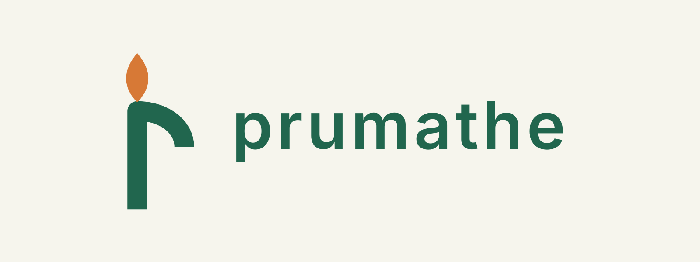

# Prumathe. Cursos para aprender tecnologías complejas

*Prumathe is the Etruscan name of Prometheus. Courses that make complex technologies learnable: see the mechanism, run the experiment, name the limit.*

## Misión

Prumathe existe para facilitar el aprendizaje de las tecnologías complejas: las que sostienen los sistemas que usamos todos los días y que la documentación oficial explica para quien ya las entiende. Entre esa documentación y la persona que necesita construir algo con ellas hay una distancia que suele cubrirse a golpes, en producción. Los cursos de Prumathe cubren esa distancia antes.

Un curso de Prumathe toma una tecnología de base (Kafka, Docker y Kubernetes, Git y GitHub, los LLMs con RAG y MCP, y las que sigan) y la vuelve aprendible para desarrolladores y arquitectos que trabajan en sistemas orientados a eventos, Java y Spring e integración empresarial. Siempre de la misma manera:

- **Se ve el mecanismo.** Cada idea tiene un modelo visual que se puede manipular: mover un señalador, hacer caer un broker, cambiar una clave. Primero la intuición, después el nombre.
- **Se prueba con las manos.** Cada lección tiene un laboratorio real, en la propia máquina, con el resultado esperado escrito antes de ejecutar y aserciones que dicen si pasó o no; las actividades sobre un servicio externo (GitHub) distinguen lo ejecutado del caso de estudio. Un diagrama no prueba nada; un experimento sí.
- **Se nombra la garantía y su límite.** Cada afirmación dice dentro de qué frontera vale ("exactamente una vez" siempre dice de qué), porque lo que da problemas en producción no es lo que la tecnología hace, sino lo que se supuso que hacía.
- **En dos idiomas, el mismo contenido.** Inglés y español rioplatense, con los términos técnicos tal como aparecen en las herramientas.
- **Verificado y fechado.** Cada afirmación sobre un producto se contrasta con su documentación oficial, las versiones se fijan y lo que no se ejecutó se dice.
- **Abierto y portable.** Un curso es una carpeta que se abre en un navegador, sin cuenta, sin servidor, sin instalar nada. Cada kit declara sus herramientas: Docker para Kafka, Docker y kind para contenedores y Kubernetes, Git y Node.js para los experimentos locales de GitHub, Docker con unos 6 GB de memoria libre para los modelos de LLMs, RAG y MCP. Licencia MIT.
- **Con lugar para preguntar.** Cada lección tiene su discusión en GitHub Discussions de este repositorio, incrustada en la pestaña Profundizá del sitio publicado (con giscus, cargado solo cuando se abre); leer es abierto, publicar pide una cuenta de GitHub.

El nombre: Prumathe es como los etruscos llamaban a Prometeo, el que le acercó a la gente el fuego y, con el fuego, los oficios. Acá el fuego son las tecnologías que mueven los sistemas de todos los días, y acercarlo quiere decir que cualquiera con ganas pueda abrirlas, tocarlas y entenderlas.

Sitio publicado: [prumathe.com](https://prumathe.com) (también responde en [prumathe.andresdiegolanda.workers.dev](https://prumathe.andresdiegolanda.workers.dev)). Repositorio: [github.com/andresdiegolanda/prumathe](https://github.com/andresdiegolanda/prumathe), con copia de trabajo local en `D:\_claude\prumathe`. Cada curso es una carpeta independiente; el primero es [`kafka-from-scratch/`](kafka-from-scratch/), y marca el patrón para los que sigan.

## Estructura

- [`site/`](site/): la portada de Prumathe, una página bilingüe que presenta el proyecto (misión, cómo funciona un curso, el nombre) y enlaza a los cuatro cursos; se abre desde el repositorio y `node site/scripts/build.mjs` arma en `site/dist/` el sitio publicable completo, con la portada en la raíz y cada curso bajo su carpeta. Detalle en su [`README.md`](site/README.md).
- [`docker-kubernetes-from-scratch/`](docker-kubernetes-from-scratch/): curso Docker y Kubernetes, v1.4.0, con 25 lecciones bilingües en 7 unidades, 75 escenas, 75 preguntas, 102 pasos de laboratorio y glosario de 40 términos. Una aplicación HTTP pequeña recorre procesos, imágenes, Compose, Pods, Deployments, Services, almacenamiento, sondas, recursos, rollouts y RBAC, sobre Docker con Compose v2 y un clúster kind (kind 0.33.0, Kubernetes 1.37.0, kubectl 1.37.x). Para cursar, [`index.html`](docker-kubernetes-from-scratch/index.html?lang=es); para quien no sabe qué son, la página [Qué son Docker y Kubernetes](docker-kubernetes-from-scratch/what-docker-and-kubernetes-are.html?lang=es): qué son, de dónde salieron, dónde encajan y dónde no; preparación en [`labs/README.md`](docker-kubernetes-from-scratch/labs/README.md), evidencia y límites en [`docs/VALIDATION.md`](docker-kubernetes-from-scratch/docs/VALIDATION.md) (las 102 prácticas ejecutadas; las de Kubernetes, por ahora, dentro del nodo kind). Un visor en vivo en http://127.0.0.1:18091 dibuja lo que crean las prácticas, en Docker y en el clúster. Carpeta independiente, cuatro apariencias y kit descargable.
- [`kafka-from-scratch/`](kafka-from-scratch/): curso de Apache Kafka, v1.6.0. 31 lecciones HTML en 9 unidades con 93 escenas visuales, 31 actividades Docker en 140 pasos sobre un clúster KRaft de tres nodos (más Connect, PostgreSQL, ACL, mirror, share groups, la consola Kafbat UI y Spring Boot como servicios opcionales), un visor en vivo en http://localhost:18090 que muestra tópicos, particiones, réplicas, registros y grupos mientras se hacen las prácticas, 93 preguntas de control (tres por lección), glosario de 46 términos, cuatro apariencias (Clásico, Oscuro, Lectura y Proyector) y apuntes descargables en los dos idiomas. La entrada es la [lección 00, Antes de empezar](kafka-from-scratch/lessons/before-you-start.html?lang=es), y para quien no sabe qué es Kafka, la página [Qué es Kafka](kafka-from-scratch/what-kafka-is.html?lang=es): qué es, de dónde salió, dónde encaja y dónde no. Para cursar, [`index.html`](kafka-from-scratch/index.html); para el resto, su [`README.md`](kafka-from-scratch/README.md). Sus documentos: [`docs/TEACHING.md`](kafka-from-scratch/docs/TEACHING.md) (cómo se enseña, cómo se edita, cómo funcionan las apariencias y dónde vive la versión), [`docs/DEPLOYMENT.md`](kafka-from-scratch/docs/DEPLOYMENT.md) (GitHub y Cloudflare Pages, como carpeta de este repositorio o como copia independiente) y [`docs/VALIDATION.md`](kafka-from-scratch/docs/VALIDATION.md) (la evidencia por versión: las cinco suites Docker ejecutadas el 19/10/2026 sobre la 1.5.0 con el visor abierto, y lo verificado y lo pendiente de cada versión). Fija Kafka 4.1.2 y Spring Boot 3.5.16 sobre Java 21. Trae su propio `.gitignore`, `.gitattributes`, licencia MIT y `package.json`; Node.js 18 o superior se usa solo para construir y empaquetar, el sitio publicado es estático.
- [`github-from-scratch/`](github-from-scratch/): curso de Git y GitHub, v1.4.0. 20 lecciones en 6 unidades, 60 escenas, 60 preguntas conceptuales, 14 experimentos locales con 41 aserciones y 6 actividades de GitHub con alternativa de caso de estudio. Un visor en vivo (`node lab.mjs visor`, http://127.0.0.1:18092) dibuja los repositorios de cada experimento; con `--step`, el experimento frena antes de cada operación. Los comandos son apoyo desplegable; se evalúa predecir y explicar cambios de estado. Glosario de 37 términos, cuatro apariencias, apuntes bilingües y kit independiente. Entrada: [Antes de empezar](github-from-scratch/lessons/before-you-start.html?lang=es); portada: [`index.html`](github-from-scratch/index.html); para quien no sabe qué son, la página [Qué son Git y GitHub](github-from-scratch/what-git-and-github-are.html?lang=es). Alcance y requisitos en su [README](github-from-scratch/README.md), método en [TEACHING.md](github-from-scratch/docs/TEACHING.md) y evidencia y límites en [VALIDATION.md](github-from-scratch/docs/VALIDATION.md).
- [`llm-rag-mcp-from-scratch/`](llm-rag-mcp-from-scratch/): curso de LLMs, RAG y MCP, v1.0.0, con 26 lecciones bilingües en 8 unidades, 78 escenas, 78 preguntas, 129 pasos de laboratorio y glosario de 61 términos. Un modelo abierto chico que corre en la CPU (Granite 4.2 3B en llama.cpp, con los embeddings y el reranker de Qwen3) y una aplicación Java con Spring AI recorren tokens, muestreo, contexto, embeddings, la API de chat, salida estructurada, tool calling, RAG sobre pgvector con búsqueda híbrida y reranker, evaluación, prompt injection y MCP en sus dos revisiones, con un servidor en Spring y un agente con consentimiento y presupuesto de llamadas; no necesita clave de API. Para cursar, [`index.html`](llm-rag-mcp-from-scratch/index.html?lang=es); para quien no sabe qué son, la página [Qué son los LLMs, RAG y MCP](llm-rag-mcp-from-scratch/what-llms-rag-and-mcp-are.html?lang=es); preparación en [`labs/README.md`](llm-rag-mcp-from-scratch/labs/README.md), evidencia y límites en [`docs/VALIDATION.md`](llm-rag-mcp-from-scratch/docs/VALIDATION.md) (127 de los 129 pasos ejecutados en una corrida secuencial; el visor en vivo de la lección 01, pendiente). Carpeta independiente, cuatro apariencias y kit descargable.
- `CHANGELOG.md`: registro de todos los cambios del repositorio.
- `wrangler.jsonc`: la publicación en Cloudflare, como Worker de archivos estáticos sin código: apunta a `site/dist` y sirve la 404 del sitio; el build es el de [`site/`](site/). Detalle en [`site/README.md`](site/README.md).
- `LICENSE`: MIT para todo el repositorio; cada curso lleva además su propia copia para poder circular solo.
- `tablero.md`: kanban del repositorio en Markdown, la fuente única de trabajo pendiente y en curso (columnas como títulos, cards de una línea con checkbox, enlace y dueño). Compatible con las extensiones kanban.md y Taskboard para vista con drag and drop.
- `reviews/`: revisiones de los cursos, una por archivo con fecha y versión revisada (`AAAA-MM-DD-<curso>-v<versión>.md`). Cada hallazgo dice cómo se estableció (leído, ejecutado, contrastado con fuente, o no verificado) y qué hacer; lo que se decide corregir pasa al tablero. Primera: [`2026-10-17-kafka-from-scratch-v1.0.0.md`](reviews/2026-10-17-kafka-from-scratch-v1.0.0.md), aplicada el mismo día en la 1.1.0 del curso. Después, las de [Docker y Kubernetes](reviews/2026-10-18-docker-kubernetes-from-scratch-v1.0.0.md) y [GitHub](reviews/2026-10-18-github-from-scratch-v1.0.0.md) del 18/10, aplicadas el mismo día en la 1.1.0 de cada curso, y la de [LLMs, RAG y MCP](reviews/2026-10-20-llm-rag-mcp-from-scratch-v1.0.0.md) del 20/10, aplicada antes de publicar la 1.0.0.
- `docs/logo/`: la identidad de Prumathe: la marca es la P del alfabeto etrusco, un asta con un gancho abierto, dibujada de un solo trazo y con una llama sobre el asta: una antorcha que es también la letra. Archivos: `prumathe-mark` (la marca), `prumathe-favicon` (dibujado aparte, con trazo más grueso para 16 px), `prumathe-lockup` (la marca con el nombre en minúscula, en Inter; la variante `-outlined` lleva el texto como trazado y es la que se usa donde no se puede contar con la tipografía), en SVG y PNG. Verde `#21664e` y naranja `#d77936` sobre papel `#f6f5ed`. Cada curso lleva su propia copia de lo que usa (favicon e ícono de la cabecera) para seguir siendo independiente; las revisiones anteriores están en `tmp/_obsoleto/logo-revisiones-2026-10-18/`.
- `.github/workflows/`: lo que GitHub corre solo, un workflow por curso en cada push que lo toque: [`validate-kafka.yml`](.github/workflows/validate-kafka.yml) (sitio, verificaciones estáticas, compilación Java y Spring, Compose), [`validate-docker-kubernetes.yml`](.github/workflows/validate-docker-kubernetes.yml) (sitio, verificaciones estáticas, Compose) y [`validate-github.yml`](.github/workflows/validate-github.yml) (sitio, verificaciones estáticas, los 14 experimentos de Git y la prueba del visor) y [`validate-llm-rag-mcp.yml`](.github/workflows/validate-llm-rag-mcp.yml) (sitio, verificaciones estáticas, Compose); las suites Docker no corren ahí.
- `metodo/`: cómo se trabaja en el repositorio. [`arranque.md`](metodo/arranque.md): qué leer al empezar, las convenciones de trabajo (commits, archivos, versiones), las particularidades de la máquina y el trabajo en paralelo. [`aprendizaje/`](metodo/aprendizaje/README.md): lo aprendido haciendo cursos que vale para los próximos (contenido, laboratorios, interfaz, versiones y fuentes, proceso), una regla por entrada con su origen y su control; se actualiza cada vez que un trabajo deja un aprendizaje.
- `tmp/`: trabajo interno no versionado (scripts de una vez, pruebas, lo que sobra en `_obsoleto/`); solo se versiona su [`README.md`](tmp/README.md).
- Próximas carpetas: un curso por carpeta, al mismo nivel que las cuatro existentes, cada uno con su README, su licencia y su validación; la portada lo toma solo al agregarle su tarjeta.

## Reglas del repositorio

1. **Un curso, una carpeta.** Cada curso vive en su carpeta, con rutas relativas, su README, su licencia, su `.gitignore` y sus documentos de enseñanza, publicación y validación; se tiene que poder copiar entero a otro lugar y seguir funcionando. Nada de un curso depende de otro ni de este nivel.
2. **Dos idiomas.** El contenido de los cursos va en inglés y en español rioplatense (voseo). Los nombres de propiedades, comandos, clases de API y las salidas de las herramientas se conservan tal como aparecen en las herramientas reales; cada término técnico se explica la primera vez que aparece. El criterio en detalle está en [`kafka-from-scratch/docs/TEACHING.md`](kafka-from-scratch/docs/TEACHING.md).
3. **Evidencia, no promesas.** Un laboratorio se marca como verificado solo si se ejecutó, y el resultado queda en el documento de validación del curso con fecha, plataforma y versiones. Los diagramas son ilustrativos y nunca se presentan como una ejecución real.
4. **Afirmaciones de producto verificadas.** Toda afirmación sobre versión, feature o comportamiento de un producto (Kafka, Spring, Docker, Cloudflare) se contrasta con documentación oficial antes de escribirse, y la fuente queda anotada. Las versiones base de cada curso se fijan; que exista una versión más nueva no justifica cambiarlas en silencio.
5. **Trazabilidad.** Todo cambio del repositorio se anota en [`CHANGELOG.md`](CHANGELOG.md), en la misma sesión que el cambio: qué cambió, dónde, y el enlace al documento que tiene el porqué.
6. **Pendientes con dueño.** Todo pendiente se registra como card en [`tablero.md`](tablero.md), con responsable explícito. Lo que no tiene dueño no ocurre.
7. **Un dueño por hecho.** Cada hecho vive en un solo lugar y los demás lo enlazan: el estado en `tablero.md`, la historia en `CHANGELOG.md`, el cómo se enseña, se publica y se validó cada curso en sus `docs/`. Un hecho repetido en dos lugares son dos versiones que se separan solas.
8. **Estilo:** sin guiones largos ni cortos en ningún archivo, ni en los documentos del repositorio ni en el contenido de los cursos en cualquiera de sus idiomas (los rangos se escriben "01 a 04" o "01 to 04"). Los documentos del repositorio van en español rioplatense; el contenido de los cursos sigue la regla 2.

## Estado

El estado vivo no se cuenta acá, para que no envejezca: está en [`tablero.md`](tablero.md) (qué está en curso y qué falta) y en las entradas recientes de [`CHANGELOG.md`](CHANGELOG.md). La versión y el grado de validación de cada curso están en su README y en su `docs/VALIDATION.md`.
