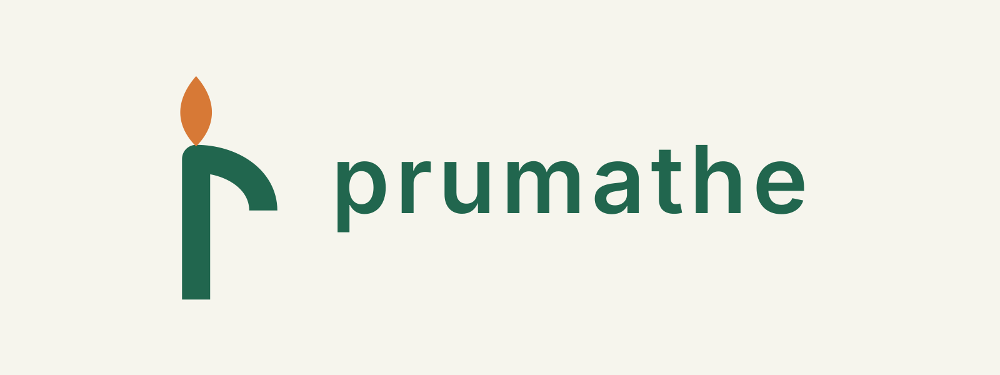

# Prumathe. Cursos para aprender tecnologías complejas

*Prumathe is the Etruscan name of Prometheus. Courses that make complex technologies learnable: see the mechanism, run the experiment, name the limit.*

## Misión

Prumathe existe para facilitar el aprendizaje de las tecnologías complejas: las que sostienen los sistemas que usamos todos los días y que la documentación oficial explica para quien ya las entiende. Entre esa documentación y la persona que necesita construir algo con ellas hay una distancia que suele cubrirse a golpes, en producción. Los cursos de Prumathe cubren esa distancia antes.

Un curso de Prumathe toma una tecnología de base (Kafka, Docker y Kubernetes, Git y GitHub, los LLMs con RAG y MCP, y las que sigan) y la vuelve aprendible para desarrolladores y arquitectos que trabajan en sistemas orientados a eventos, Java y Spring e integración empresarial. Siempre de la misma manera:

- **Se ve el mecanismo.** Cada idea tiene un modelo visual que se puede manipular: mover un señalador, hacer caer un broker, cambiar una clave. Primero la intuición, después el nombre.
- **Se prueba con las manos.** Cada lección tiene un laboratorio real, en la propia máquina, con el resultado esperado escrito antes de ejecutar y aserciones que dicen si pasó o no; las actividades sobre un servicio externo (GitHub) distinguen lo ejecutado del caso de estudio. Un diagrama no prueba nada; un experimento sí.
- **Se nombra la garantía y su límite.** Cada afirmación dice dentro de qué frontera vale ("exactamente una vez" siempre dice de qué), porque lo que da problemas en producción no es lo que la tecnología hace, sino lo que se supuso que hacía.
- **En dos idiomas, el mismo contenido.** Todos los cursos están en inglés y en español rioplatense, con los términos técnicos tal como aparecen en las herramientas.
- **Verificado y fechado.** Cada afirmación sobre un producto se contrasta con su documentación oficial, las versiones se fijan y lo que no se ejecutó se dice.
- **Abierto y portable.** Un curso es una carpeta que se abre en un navegador, sin cuenta, sin servidor, sin instalar nada. Cada kit declara sus herramientas: Docker para Kafka, Docker y kind para contenedores y Kubernetes, Git y Node.js para los experimentos locales de GitHub, Docker con unos 6 GB de memoria libre para los modelos de LLMs, RAG y MCP. Licencia MIT.
- **Con lugar para preguntar.** Los cursos con foro habilitado tienen su discusión por lección en GitHub Discussions de este repositorio, incrustada en la pestaña Profundizá del sitio publicado (con giscus, cargado solo cuando se abre); leer es abierto, publicar pide una cuenta de GitHub. Microsoft Entra todavía no integra el foro.

El nombre: Prumathe es como los etruscos llamaban a Prometeo, el que le acercó a la gente el fuego y, con el fuego, los oficios. Acá el fuego son las tecnologías que mueven los sistemas de todos los días, y acercarlo quiere decir que cualquiera con ganas pueda abrirlas, tocarlas y entenderlas.

Sitio publicado: [prumathe.com](https://prumathe.com) (también responde en [prumathe.andresdiegolanda.workers.dev](https://prumathe.andresdiegolanda.workers.dev)). Repositorio: [github.com/andresdiegolanda/prumathe](https://github.com/andresdiegolanda/prumathe), con copia de trabajo local en `D:\_claude\prumathe`. Cada curso es una carpeta independiente; el primero es [`kafka-from-scratch/`](kafka-from-scratch/), y marca el patrón para los que sigan.

## Estructura

Cada curso es una carpeta independiente y es el dueño de sus datos: su versión, sus conteos, las versiones de producto que fija y sus requisitos están en su `README.md`, y lo que se ejecutó y lo que no, en su `docs/VALIDATION.md` (regla 7).

- [`entra-from-scratch/`](entra-from-scratch/): Microsoft Entra desde cero. La autenticación y la autorización seguidas por una app Angular con MSAL, una API Spring Security y PostgreSQL, desde el inicio de sesión de Windows hasta la fila. [README](entra-from-scratch/README.md) y [validación](entra-from-scratch/docs/VALIDATION.md).
- [`kafka-from-scratch/`](kafka-from-scratch/): Apache Kafka desde cero, el primer curso y el que marca el patrón. El log, las particiones, la replicación, los grupos de consumidores, exactly once y su frontera, Connect, Streams, seguridad y share groups, sobre un clúster KRaft de tres nodos en Docker. [README](kafka-from-scratch/README.md), [cómo se enseña](kafka-from-scratch/docs/TEACHING.md) y [validación](kafka-from-scratch/docs/VALIDATION.md).
- [`docker-kubernetes-from-scratch/`](docker-kubernetes-from-scratch/): Docker y Kubernetes desde cero. Una aplicación HTTP pequeña seguida desde su proceso hasta un despliegue en Kubernetes, sobre Docker con Compose y un clúster kind. [README](docker-kubernetes-from-scratch/README.md) y [validación](docker-kubernetes-from-scratch/docs/VALIDATION.md).
- [`github-from-scratch/`](github-from-scratch/): Git y GitHub desde cero. Qué cambia, dónde y para quién, con experimentos locales de Git y actividades en GitHub que tienen alternativa de caso de estudio. [README](github-from-scratch/README.md) y [validación](github-from-scratch/docs/VALIDATION.md).
- [`llm-rag-mcp-from-scratch/`](llm-rag-mcp-from-scratch/): LLMs, RAG y MCP desde cero. Qué hace un modelo de lenguaje, token a token, y después RAG con fuentes, evaluación, prompt injection y MCP, sobre un modelo abierto chico que corre en la CPU, sin clave de API. [README](llm-rag-mcp-from-scratch/README.md) y [validación](llm-rag-mcp-from-scratch/docs/VALIDATION.md).
- [`cloudflare-from-scratch/`](cloudflare-from-scratch/): Cloudflare desde cero. Un pedido seguido desde el DNS hasta el origen, con Workers y el estado en el borde simulados en la propia máquina, sin cuenta. [README](cloudflare-from-scratch/README.md) y [validación](cloudflare-from-scratch/docs/VALIDATION.md).
- [`site/`](site/): la portada de Prumathe, una página bilingüe que presenta el proyecto y enlaza a los cursos. `node site/scripts/build.mjs` arma en `site/dist/` el sitio publicable completo, con la portada en la raíz y cada curso bajo su carpeta. Detalle en su [`README.md`](site/README.md).
- `CHANGELOG.md`: registro de todos los cambios del repositorio.
- `scripts/`: [`check.mjs`](scripts/check.mjs), el control de raíz. Controla lo que ningún curso puede controlar de sí mismo (los archivos y los enlaces de este nivel, el motor común del panorama, los puertos locales, lo que la portada repite de cada curso y el tablero) y avisa cuando un dato aparece en más de un documento vigente. Se corre con `node scripts/check.mjs`.
- `wrangler.jsonc`: la publicación en Cloudflare, como Worker de archivos estáticos sin código: apunta a `site/dist` y sirve la 404 del sitio; el build es el de [`site/`](site/). Detalle en [`site/README.md`](site/README.md).
- `LICENSE`: MIT para todo el repositorio; cada curso lleva además su propia copia para poder circular solo.
- `tablero.md`: kanban del repositorio en Markdown, la fuente única de trabajo pendiente y en curso: columnas como títulos ("En curso", "Para empezar", "Esperando" y "Hecho"), cards de una línea con checkbox, enlace y dueño, y el orden de "Para empezar" como prioridad. Compatible con las extensiones kanban.md y Taskboard para vista con drag and drop.
- `reviews/`: revisiones de los cursos, una por archivo con fecha y versión revisada (`AAAA-MM-DD-<curso>-v<versión>.md`). Cada hallazgo dice cómo se estableció (leído, ejecutado, contrastado con fuente, o no verificado) y qué hacer; lo que se decide corregir pasa al tablero. La carpeta es la lista: cada curso tiene la revisión de su primera versión.
- `docs/logo/`: la identidad de Prumathe: la marca es la P del alfabeto etrusco, un asta con un gancho abierto, dibujada de un solo trazo y con una llama sobre el asta: una antorcha que es también la letra. Archivos: `prumathe-mark` (la marca), `prumathe-favicon` (dibujado aparte, con trazo más grueso para 16 px), `prumathe-lockup` (la marca con el nombre en minúscula, en Inter; la variante `-outlined` lleva el texto como trazado y es la que se usa donde no se puede contar con la tipografía), en SVG y PNG. Verde `#21664e` y naranja `#d77936` sobre papel `#f6f5ed`. Cada curso lleva su propia copia de lo que usa (favicon e ícono de la cabecera) para seguir siendo independiente; las revisiones anteriores están en `tmp/_obsoleto/logo-revisiones-2026-10-18/`.
- `.github/workflows/`: lo que GitHub corre solo. Un workflow por curso construye su sitio y corre sus verificaciones estáticas en cada push que lo toque; el de Kafka compila además el cliente Java y el ejemplo de Spring, el de GitHub corre los experimentos de Git y la prueba del visor, y el de Microsoft Entra, los escenarios de autorización contra su Compose. [`validate-repo.yml`](.github/workflows/validate-repo.yml) corre en cada push el control de raíz. [`suites.yml`](.github/workflows/suites.yml) corre en un runner de Linux las suites de laboratorio de Docker y Kubernetes y de Kafka: de noche, si `main` cambió en el último día, y a demanda; las de los demás cursos siguen corriendo solo en una laptop.
- `metodo/`: cómo se trabaja en el repositorio. [`arranque.md`](metodo/arranque.md): qué leer al empezar, cómo empieza y termina una tarea, el tamaño de cada cambio, el dueño de cada hecho, las convenciones de trabajo (commits, archivos, versiones), lo temporal, las particularidades de la máquina y el trabajo en paralelo. [`aprendizaje/`](metodo/aprendizaje/README.md): lo aprendido haciendo cursos que vale para los próximos (contenido, laboratorios, interfaz, versiones y fuentes, proceso), una regla por entrada con su origen y su control; se actualiza cada vez que un trabajo deja un aprendizaje.
- `tmp/`: trabajo temporal no versionado (scripts de una vez, pruebas, registros), que se puede vaciar, salvo `_obsoleto/`, donde queda lo que se retira del repositorio; solo se versiona su [`README.md`](tmp/README.md).
- Próximas carpetas: un curso por carpeta, al mismo nivel que las existentes, cada uno con su README, su licencia y su validación; la portada lo toma solo al agregarle su tarjeta.

## Reglas del repositorio

1. **Un curso, una carpeta.** Cada curso vive en su carpeta, con rutas relativas, su README, su licencia, su `.gitignore` y sus documentos de enseñanza, publicación y validación; se tiene que poder copiar entero a otro lugar y seguir funcionando. Nada de un curso depende de otro ni de este nivel.
2. **Dos idiomas.** El contenido de los cursos va en inglés y en español rioplatense (voseo). Los nombres de propiedades, comandos, clases de API y las salidas de las herramientas se conservan tal como aparecen en las herramientas reales; cada término técnico se explica la primera vez que aparece. El criterio en detalle está en [`kafka-from-scratch/docs/TEACHING.md`](kafka-from-scratch/docs/TEACHING.md).
3. **Evidencia, no promesas.** Un laboratorio se marca como verificado solo si se ejecutó, y el resultado queda en el documento de validación del curso con fecha, plataforma y versiones. Los diagramas son ilustrativos y nunca se presentan como una ejecución real.
4. **Afirmaciones de producto verificadas.** Toda afirmación sobre versión, feature o comportamiento de un producto (Kafka, Spring, Docker, Cloudflare) se contrasta con documentación oficial antes de escribirse, y la fuente queda anotada. Las versiones base de cada curso se fijan; que exista una versión más nueva no justifica cambiarlas en silencio.
5. **Trazabilidad.** Todo cambio del repositorio se anota en [`CHANGELOG.md`](CHANGELOG.md), en la misma sesión que el cambio: qué cambió, dónde, y el enlace al documento que tiene el porqué.
6. **Pendientes con dueño.** Todo pendiente se registra como card en [`tablero.md`](tablero.md), con responsable explícito. Lo que no tiene dueño no ocurre.
7. **Un dueño por hecho.** Cada hecho vive en un solo lugar y los demás lo enlazan: el estado en `tablero.md`, la historia en `CHANGELOG.md`, el cómo se enseña, se publica y se validó cada curso en sus `docs/`. Un hecho repetido en dos lugares son dos versiones que se separan solas. La tabla de dueños está en [`metodo/arranque.md`](metodo/arranque.md).
8. **Estilo:** sin guiones largos ni cortos en ningún archivo, ni en los documentos del repositorio ni en el contenido de los cursos en cualquiera de sus idiomas (los rangos se escriben "01 a 04" o "01 to 04"). Los documentos del repositorio van en español rioplatense; el contenido de los cursos sigue la regla 2.

## Estado

El estado vivo no se cuenta acá, para que no envejezca: está en [`tablero.md`](tablero.md) (qué está en curso y qué falta) y en las entradas recientes de [`CHANGELOG.md`](CHANGELOG.md). La versión y el grado de validación de cada curso están en su README y en su `docs/VALIDATION.md`.
